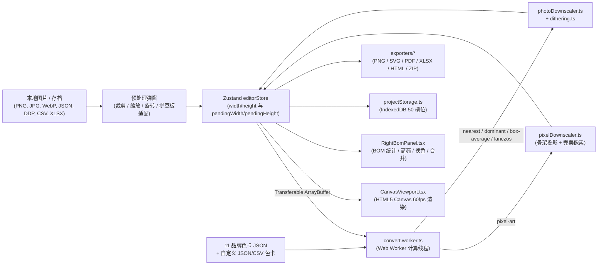

# Bead Studio (`web-fuser`) 项目接手与维护文档

> 本文档面向后续接手开发、维护或二次扩展的工程师，系统梳理项目的技术架构、目录结构、核心不变量、算法流水线、构建测试与 GitHub Pages 部署流程。

---

## 1. 项目概览

- **GitHub 仓库**：https://github.com/Electr0Whale/web-fuser （主分支 `main`）
- **线上部署地址**：https://electr0whale.github.io/web-fuser/
- **项目定位**：完全在浏览器端运行的纯静态拼豆（Fuse / Perler Beads）图纸生成与像素编辑器，无任何后端服务或授权限制。
- **核心技术栈**：
  - **前端框架**：React 19 + TypeScript 5.7（`strict: true`）
  - **构建与测试**：Vite 6 + Tailwind CSS v4 (`@tailwindcss/vite`) + Vitest + jsdom
  - **状态管理**：Zustand 5（`src/store/editorStore.ts`）
  - **异步计算**：原生 ES Module Web Worker（`src/workers/convert.worker.ts`）
  - **数据持久化**：IndexedDB（主存储，最多 50 槽位）+ `localStorage` 降级镜像
  - **文件导出库**：`jspdf`（A4 分页 PDF）、`xlsx`（SheetJS Excel 读写）、`jszip`（全格式 ZIP 打包）、`lucide-react`（矢量图标）

---

## 2. 开发环境与常用命令

- **Node.js 要求**：建议 Node.js `v22+`（本地开发验证环境为 `v24.15.0`，CI 使用 Node `22`）。
- **常用脚本**（定义于 `package.json`）：

| 命令 | 用途 |
| :--- | :--- |
| `npm ci` | 依据 `package-lock.json` 锁定安装依赖 |
| `npm run dev` | 启动 Vite 本地开发服务器 |
| `npm test` | 运行 Vitest 全量单元测试（`vitest run`） |
| `npm run test:watch` | 监听模式运行单元测试 |
| `npm run build` | 执行 `tsc -b && vite build` 生产构建（输出至 `dist/`） |
| `npm run preview` | 启动静态生产包预览服务器（默认端口 `4173`） |

> [!NOTE]
> 在 Windows PowerShell 5.1 中不支持 `&&` 串联命令，请使用分号与退出码检查：`npm test; if ($LASTEXITCODE -eq 0) { npm run build }`。

---

## 3. 目录结构与整体数据流

```text
web-fuser/
├── .github/workflows/deploy.yml       # GitHub Actions 自动测试 + Pages 发布
├── index.html                         # 页面入口与 Google Fonts / Noto Sans SC 引入
├── package.json / package-lock.json   # 依赖与脚本
├── tsconfig.json                      # 严格 TypeScript 配置
├── vite.config.ts                     # base 相对路径配置 + ES Worker + Vitest 配置
├── HANDOFF.md                         # 本接手文档
└── src/
    ├── main.tsx                       # React 挂载入口
    ├── App.tsx                        # 顶层布局、快捷键、自动保存、主题同步与弹窗调度
    ├── index.css                      # Tailwind 导入 + Gemini 风格表面/阴影工具类 + Callout
    ├── styles/tokens.css              # Light / Dark 语义化 Design Tokens
    ├── vite-env.d.ts                  # Vite 客户端类型声明
    ├── data/palettes/                 # 11 套内置拼豆色卡 JSON + 解析器
    │   ├── index.ts                   # BUILTIN_PALETTES、THEME_SWATCH_PRESETS、CSV/JSON 解析
    │   └── *.json                     # mard-221/291, youken-c197/m221/418, coco, manman, mixiaowo, panpan, hama-midi, perler
    ├── core/                          # 纯算法与编辑逻辑（零 UI 依赖，可独立单测）
    │   ├── colorSpace.ts              # sRGB↔Lab、CIE76/CIEDE2000、PaletteMatcher、Top-N 筛选
    │   ├── dithering.ts               # 6 种抖动实现（Floyd–Steinberg / Atkinson / Sierra Lite / Bayer 4×4 & 8×8）
    │   ├── pixelDownscaler.ts         # 智能像素画拓扑保线缩小引擎（Zhang-Suen + L 角修形）
    │   ├── photoDownscaler.ts         # 通用多算法缩小引擎（Nearest / Dominant / Box-Average / Lanczos-3）
    │   ├── imagePreprocess.ts         # 最长边等比适配、裁剪比例计算、离屏旋转/翻转/裁剪渲染
    │   ├── backgroundRemoval.ts       # 边缘泛洪一键去背景算法
    │   ├── editingTools.ts            # 画笔连线、矩形、油漆桶、镜像、全局换色、杂色合并、BOM 统计
    │   └── __tests__/                 # 核心算法单元测试
    ├── workers/
    │   └── convert.worker.ts          # 异步图像转换 Web Worker（Transferable ArrayBuffer）
    ├── store/
    │   └── editorStore.ts             # Zustand 全局状态、异步转换协调与 10–100 步历史栈
    ├── storage/
    │   └── projectStorage.ts          # IndexedDB 50 槽位工程读写 + JSON/DDP/CSV/XLSX 导入
    ├── exporters/                     # 纯前端多格式导出器
    │   ├── pngExporter.ts             # 高清 PNG 图纸渲染（默认主导出）
    │   ├── svgExporter.ts             # 矢量 SVG 文档生成
    │   ├── pdfExporter.ts             # jsPDF A4 单页 / 5mm 分区分页排版
    │   ├── xlsxExporter.ts            # SheetJS 双表（材料清单 + 像素网格矩阵）
    │   ├── htmlExporter.ts            # 独立响应式可勾选 HTML 材料清单
    │   ├── archiveExporter.ts         # JSON/DDP 存档与 JSZip 一键打包
    │   └── __tests__/exporters.test.ts
    └── components/                    # 桌面三栏 + 移动端四标签工作台 UI
        ├── HeaderBar.tsx              # 顶部 64px 导航栏（重命名、工程操作、主题切换、帮助）
        ├── LeftControlPanel.tsx       # 左侧 280px 参数区（上传/去背景 + 01~04 手风琴）
        ├── CanvasToolbar.tsx          # 中央工具栏（绘图工具、镜像、#色号、历史弹窗、复原、缩放）
        ├── CanvasViewport.tsx         # 高性能 HTML5 Canvas 渲染器（200×200 视口裁剪 + 四边标尺）
        ├── RightBomPanel.tsx          # 右侧 296px BOM 清单、主题色板、杂色合并与导出入口
        ├── MobileWorkbench.tsx        # <1024px 移动端四标签工作台与底部工具栏
        ├── ImagePreprocessModal.tsx   # 上传/二次编辑时的交互式裁剪、缩放、旋转预处理弹窗
        └── Modals.tsx                 # 导出弹窗、全色卡库、全局换色、统计、工程管理、帮助与致谢
```



---

## 4. 核心子系统与关键不变量（接手必读）

### 4.1 拼豆品牌色卡数据（`src/data/palettes/`）
- 内置 **11 套**社区色卡 JSON（已预计算 `rgb` 与 CIELAB `lab` 坐标以加速实时匹配）：
  - `mard-221`、`mard-291`、`youken-c197`、`youken-m221`、`youken-418`、`coco-291`、`manman-278`、`mixiaowo-290`、`panpan-289`、`hama-midi`（92 色）、`perler`（103 色）。
- 支持用户导入自定义 `.json` / `.csv` 色卡（`parseCustomPaletteFile`），自动解析 `code,name,#HEX` 或 `code,name,R,G,B` 并实时计算 `lab`。

### 4.2 图片预处理与非正方形等比适配（`src/core/imagePreprocess.ts`）
- **核心业务规则**：预设拼豆板尺寸（`29 / 52 / 78 / 104 / 128 / 156`）代表拼豆板的物理边长。
- 导入图片或点击预设尺寸时，开启比例锁定时调用 `fitDimensionsToMaxSide(imgW, imgH, maxSide)`：保证**最长边等于预设尺寸**，短边按原图比例缩放并限制在 `[8, 200]`，确保图案完整落入拼豆板且不被强行拉成正方形。
- 单轴输入修改时调用 `fitDimensionsByAxis`，在另一轴超过 `200` 格时自动反向收敛，不破坏宽高比。
- **非破坏性预处理**（`ImagePreprocessModal.tsx`）：上传图片自动打开预处理弹窗（挂载于 `document.body` Portal 上），保留原始图片引用 `sourceImage.raw` 与 `cropState`，可随时点击左侧 `裁剪 / 缩放预处理` 重新裁剪。
  - **关键实现细节**：锁定裁剪比例（`original` / `1:1` / `3:4` / `4:3`）拖拽角点时，所有宽高计算必须在**旋转后的像素空间 `(rotW, rotH)`** 内进行，切勿直接在归一化 `[0..1]` 空间计算，否则非正方形图片选择 `1:1` 会产生比例漂移。

### 4.3 图像转换双引擎、色距匹配与抖动（`src/core/`）
- **5 种下采样算法**：
  1. `pixel-art`（`pixelDownscaler.ts`）：杂色去噪（`cleanStrayPaletteColors`）→ 形态学高对比细线检测（`detectThinStrokes`）→ 面积覆盖投票（`areaOverlapDownscaleRgb`）→ 细线投影 + Zhang-Suen 细化 + L 型双点清理（`projectAndThinStroke` / `applyPixelPerfectCleanup`）。
  2. `nearest`：中心点最近邻采样，适合 1:1 或硬边缘像素图。
  3. `dominant`：5-bit RGB 分桶加权主色投票，减少扁平插画边缘混色。
  4. `box-average`：子像素面积加权平均，色调过渡柔和。
  5. `lanczos`：两遍可分离 Lanczos-3 重采样（带 Alpha 预乘归一化防透明边缘黑边）。
- **6 种抖动模式**（`dithering.ts`）：`none`、`floyd-steinberg`、`atkinson`、`sierra-lite`、`bayer-4x4`、`bayer-8x8`，支持 `ditherStrength`（`0.1–1.0`）调节；误差扩散会先拷贝工作缓冲区，不污染原始重采样缓冲区。
- **色彩匹配与限色**：`PaletteMatcher` 使用 24-bit RGB `Map` 缓存；设置 `maxColors`（`24/48/72/96/120/144`）时，先全色卡统计频次，再用带次线性权重（`count^0.65`）的边际误差缩减算法 `selectTopNPaletteIndices` 选出兼具主色块与小面积高对比特征（如眼睛/肤色）的代表色子集，最后重映射。

### 4.4 `editorStore.ts` 关键不变量与防竞态设计
1. **`grid.length === width * height` 严格不变量**：
   - 当存在 `sourceImage` 且用户修改目标尺寸时，先更新 `pendingWidth` / `pendingHeight` 并向 Worker 投递请求；只有 Worker 返回结果调用 `applyResult` 时，才同步提交新 `width`、`height` 和新 `grid`。
   - 切勿在异步转换完成前直接改写与 `grid` 绑定的 `width` / `height`，否则 `CanvasViewport` 会用新跨度索引旧数组引发越界与斜向错位。
2. **过期 Worker 请求丢弃**：每次 `runConversion()` 递增模块级 `convertSeq`，回调校验 `data.requestId === convertSeq` 后才写入状态。
3. **深色模式即时同步刷新**：
   - `setTheme` 同步调用 `applyThemeToDom(theme)` 写入 `document.documentElement[data-theme]`；`App.tsx` 使用 `useLayoutEffect` 并监听系统 `prefers-color-scheme`；`CanvasViewport.tsx` 订阅 `theme` 并辅以 `MutationObserver` 监听 `data-theme`，确保画布背景与四边标尺在切换瞬间重绘，无需鼠标移动或缩放触发。
4. **历史记录与复原**：支持 `10–100` 步可配撤销栈、任意节点跳转 `jumpToHistory(idx)` 以及 `resetToInitial()` 复原至初始状态。

### 4.5 `CanvasViewport.tsx` 高性能渲染注意事项
- 网格存储为一维 `Int16Array`（`-1` 表示空位，`>= 0` 为当前品牌色板索引）。
- 渲染阶段通过 `minCol..maxCol` 与 `minRow..maxRow` 做视口可见区域裁剪，支持 `200×200`（40,000 格）下 60fps 平滑缩放（`10%–400%`）与拖拽。
- 鼠标拖动涂抹期间将临时改动写入 `draftGridRef.current`，仅触发局部重绘，抬起鼠标 `onPointerUp` 时才一次性调用 `commitGridChange` 推入撤销栈。
- 绘制画板底部环境阴影时使用 `ctx.save()` / `ctx.restore()` 包裹，**绝对不要**把 `shadowBlur` 留在后续 40,000 个格子绘制的上下文上。

### 4.6 导出系统与字体处理（`src/exporters/`）
- **导出弹窗主次层级**：主蓝色高亮按钮为 `导出 PNG 高清图`，次级 2 列网格依次为 `PDF 打印版`、`SVG 矢量`、`打包下载 (ZIP)`、`XLSX 表格`、`HTML 清单`、`JSON/DDP`。
- **PDF 中文防乱码机制**（`pdfExporter.ts`）：`jsPDF` 内置字体不支持 CJK 字形，因此采用**混合渲染**——网格与标尺/色号使用矢量矩形与等宽 Courier 绘制（色号均为 ASCII），含中文的页眉横幅与材料清单页则先在离屏 Canvas 上高分辨率绘制，再作为 PNG 嵌入 PDF，既保证体积小巧又避免中文变豆腐块。

### 4.7 UI 视觉系统（`src/styles/tokens.css` & `src/index.css`）
- 基于 Material Design 3 语义 Token（Light `#FFFFFF`/`#F0F4F9`，Dark `#131314`/`#1E1F20`）结合 Gemini 风格的半透明发丝描边（`--md-outline-subtle` / `--md-outline-variant`）与多层柔和阴影（`.gemini-card`、`.gemini-pill`、`.gemini-modal`、`.gemini-tonal-btn`）。
- 桌面端（`>=1024px`）为三栏工作台；窄屏（`<1024px`）自动切换为 `MobileWorkbench.tsx` 四标签 + 底部工具栏。

---

## 5. 测试覆盖与验证清单

当前测试套件位于 `src/**/__tests__/*.test.ts`，执行 `npm test` 运行以下 6 个测试文件（共 25 个用例）：

| 测试文件 | 覆盖范围 |
| :--- | :--- |
| `src/core/__tests__/colorSpace.test.ts` | 11 套色卡完整性、sRGB↔Lab、CIEDE2000 单调性、MARD 匹配、Top-N 筛选 |
| `src/core/__tests__/pixelDownscaler.test.ts` | 杂色清理、斜向细线 8 连通投影、Zhang-Suen 骨架化、色数上限约束 |
| `src/core/__tests__/dithering.test.ts` | 全部 6 种抖动模式 + 4 种标准重采样算法 + 透明区域保留 |
| `src/core/__tests__/imagePreprocess.test.ts` | 最长边拼豆板适配、单轴联动与 200 上限收敛、裁剪比例/缩放、`applyBoardPreset` |
| `src/core/__tests__/editingTools.test.ts` | 4 向镜像、Bresenham 连线、油漆桶边界、杂色合并/换色、边缘去背景、历史回滚 |
| `src/exporters/__tests__/exporters.test.ts` | BOM 颗数守恒、SVG XML 结构、JSON 存档无损还原、HTML 清单、XLSX 双工作表 |

---

## 6. CI/CD 与 GitHub Pages 部署机制

- **相对路径打包**：`vite.config.ts` 配置 `base: process.env.GITHUB_PAGES_BASE || './'`，使 `dist/index.html` 引用 `./assets/...`，无论托管于 `https://<user>.github.io/<repo>/` 子路径还是自定义域名均可正确加载资源与 Web Worker。
- **自动部署工作流**（`.github/workflows/deploy.yml`）：
  1. `push` 到 `main` 分支或手动触发 `workflow_dispatch`；
  2. `build` 任务运行 `npm ci && npm test && npm run build`，并将 `./dist` 上传为 Pages Artifact；
  3. `deploy` 任务使用 `actions/deploy-pages@v4` 发布上线。
- **`.gitignore` 注意事项**：根目录临时对比图与产物（`dist`、`node_modules`、`scratch`、`browser_evidence`、`browser_sandbox`、`.user_uploaded`、`*.metadata.json`、`comparison_4x_zoom.png`、`output_*.png`、`results.md`）均已忽略，提交前请保持仓库整洁。

---

## 7. 常见扩展指南与后续可优化项

### 常见扩展方式
- **新增拼豆品牌色卡**：在 `src/data/palettes/` 放入规范化 JSON（`{ id, label, colors: [{ code, name, hex, rgb, lab, group }] }`），并在 `src/data/palettes/index.ts` 的 `BUILTIN_PALETTES` 数组中注册。
- **新增抖动或重采样算法**：在 `src/core/dithering.ts` 扩展 `DitherMode` 与核矩阵，或在 `src/core/photoDownscaler.ts` 新增重采样函数并在 `src/workers/convert.worker.ts` 的 `ALGORITHM_OPTIONS` 中注册即可自动出现在 UI 中。
- **新增导出格式**：在 `src/exporters/` 中编写独立导出模块（输入 `grid`, `width`, `height`, `palette`），在 `src/components/Modals.tsx` 的 `ExportModal` 及 `archiveExporter.ts`（ZIP 打包）中接入按钮即可。

### 后续可优化项
1. **首屏分包优化**：当前生产构建主包约 `1.59 MB`（主要来自 `jspdf`、`xlsx`、`jszip` 同步打入主 bundle），后续可在 `ExportModal` 与 `projectStorage.ts` 中改用动态 `import()` 懒加载导出与表格解析库，显著降低首屏加载体积。
2. **弹窗键盘无障碍增强**：目前 `CanvasToolbar` 历史浮窗支持 `Esc` 关闭，`ModalShell` 与 `ImagePreprocessModal` 也可补充全局 `Escape` 监听快速关闭。
3. **Actions Runner 升级**：`.github/workflows/deploy.yml` 中的 `actions/checkout@v4`、`actions/setup-node@v4`、`actions/upload-pages-artifact@v3`、`actions/deploy-pages@v4` 在 Actions 日志中有 Node 20 即将弃用的提示，后续可根据官方发布升级至新版 action。
