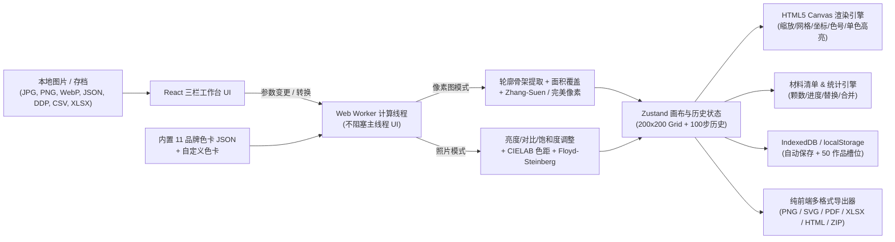

# 网页拼豆图纸生成器（GitHub Pages 纯静态版）实施计划

## Goal Description

构建一个完全在用户浏览器本地运算、不依赖任何后端服务器、可直接托管于 **GitHub Pages** 的开源静态网页拼豆图纸编辑器（拟定项目目录：`C:\Users\Admin\.gemini\antigravity\scratch\bead-pattern-studio`）。

本应用将在功能结构与核心工作流上全面对齐 [豆豆拼在线编辑器](https://doudoupin.cn/editor)（高效三栏桌面工作台 + 移动端四标签工作台），移除卡密授权/每日导出限额/弹窗等商业化限制；**UI 视觉与交互语言严格遵循 Google 官方 Material Design 3 (M3) 规范与 Google 文档风格指南**（支持 Light / Dark 自动与手动切换、色调表面层级无厚重阴影、胶囊按钮、4/8px 网格与 WCAG AA 无障碍规范），并强化以下核心能力：
1. **双引擎纯前端图片转图纸算法（Web Worker 异步运算）**：
   - **像素画/插画模式**：将此前验证的“调色盘提纯 → 嵌套边框检测 → 轮廓骨架拓扑投影（Zhang-Suen + 完美像素 L 型拐角消除）→ 面积覆盖重采样”移植为 TypeScript，保住 1px 细线与硬边缘。
   - **照片/写实模式**：支持亮度/对比度/饱和度调节、盒式/双线性重采样、CIELAB 感知色距（CIEDE2000 / CIE76）匹配及可选 Floyd–Steinberg 抖动。
2. **完整 11 套社区拼豆品牌色卡 + 颜色数量智能限缩 + 自定义色卡导入**。
3. **200×200 高性能画布与增强型像素编辑工具**：在原版画笔/橡皮/取色/撤销重做/步骤回滚基础上，新增**油漆桶填充、直线、矩形、水平/垂直镜像对称、全局换色/杂色合并、BOM 单色高亮**。
4. **全格式纯前端导出与本地工程管理**：支持 `PNG`、`SVG`（新增矢量打印）、`PDF`（A4 智能分页）、`XLSX`、`HTML 清单`、`JSON/DDP` 存档以及一键 `ZIP` 打包，全部由浏览器本地生成下载。

---

## User Review Required

> [!IMPORTANT]
> **色卡数据来源与一致性说明**：
> 11 套拼豆品牌色卡（`MARD 221`、`MARD 291`、`优肯 C197/M221/418`、`COCO 291`、`漫漫 278`、`咪小窝 290`、`盼盼 289`、`Hama Midi 92`、`Perler 103`）将优先从开源社区仓库（如 `HansBug/pindou-color-data`、`Zippland/perler-beads`、`maxcleme/beadcolors`）拉取并规范化为内置静态 JSON。若个别小众细分系列（如优肯 C197/M221 的部分社区对照项）在公开仓库中存在版本差异，将在代码中保留清晰的源数据注释，同时支持用户导入自定义 JSON/CSV 色卡覆盖。

> [!NOTE]
> **项目存放位置与 GitHub Pages 托管**：
> 实施阶段将在 `C:\Users\Admin\.gemini\antigravity\scratch\bead-pattern-studio` 创建独立 Vite 项目，并内置 `.github/workflows/deploy.yml` 与相对路径配置（`base: './'` 或环境变量自动适配仓库名），你只需推送到任意 GitHub 仓库并开启 Pages（GitHub Actions）即可零成本上线。

---

## System Architecture



---

## Proposed Changes

以下为计划在 `C:\Users\Admin\.gemini\antigravity\scratch\bead-pattern-studio` 中新建的完整工程结构与核心模块设计：

### 1. 项目脚手架与 GitHub Pages 部署配置

#### [NEW] package.json
- 核心依赖：`react`、`react-dom`、`zustand`（轻量高性能状态管理）、`lucide-react`（图标）、`jspdf`（纯前端 A4 分页 PDF 导出）、`xlsx` / `exceljs`（或轻量 `xlsx` 导出表格与导入解析）、`jszip`（一键打包带走 ZIP）。
- 开发依赖：`vite`、`typescript`、`tailwindcss`、`@tailwindcss/vite`（或 Tailwind v3/v4）、`vitest`、`@testing-library/react`、`jsdom`。

#### [NEW] vite.config.ts
- 配置 `base: process.env.GITHUB_PAGES_BASE || './'`，确保无论部署在 `https://<user>.github.io/<repo>/` 还是自定义域名/本地静态预览都能正确加载资源与 Web Worker。

#### [NEW] .github/workflows/deploy.yml
- 自动在 `push` 到 `main` 分支时执行 `npm ci && npm test && npm run build`，并将 `dist/` 发布到 GitHub Pages。

---

### 2. 拼豆色卡数据系统（11 套品牌全覆盖）

#### [NEW] src/data/palettes/index.ts
#### [NEW] src/data/palettes/*.json
- 统一色卡数据结构：
```ts
export interface BeadColor {
  code: string;      // 如 "A1", "H12", "M15"
  name: string;      // 中文/英文色名，如 "浅黄"、"暖白"
  hex: string;       // "#FAF5CD"
  rgb: [number, number, number];
  lab: [number, number, number]; // 预计算 CIELAB，加速实时匹配
  group?: string;    // 色系分组（A/B/C... 或色系名）
}

export interface BeadBrandPalette {
  id: string;        // e.g., "mard-221", "mard-291", "youken-c197", ...
  label: string;     // 显示名称，如 "MARD 221（社区版）· 221 色"
  colors: BeadColor[];
}
```
- 实施时通过脚本从开源社区仓库拉取并验证 11 套品牌数据，同时为“已用主题色板”内置 `奶油熊`、`马卡龙`、`复古像素` 等常用精选快捷色组，并支持用户上传自定义 `.json` / `.csv` 色卡文件。

---

### 3. 纯前端双引擎转换与色彩匹配（Web Worker）

#### [NEW] src/core/colorSpace.ts
- 实现 sRGB ↔ Linear RGB ↔ CIELAB 转换及 **CIEDE2000** / **CIE76** 色差函数（含快速查找表或批量向量化计算，保证 `200×200` 实时预览在 50~150ms 内完成）。
- 实现“颜色数量限制（24/48/72/96/120/144/全部）”的**主色相智能筛选算法**：先统计图像在全量色卡下的初始匹配频率与显著色差覆盖（加权 K-Means/Medoid 选出代表性 Top-N 色号），再将全图重映射到该 Top-N 子集，避免简单截断导致人物肤色或关键眼睛色丢失。

#### [NEW] src/core/pixelDownscaler.ts
- 完整移植我们已验证的 Python 算法到 TypeScript（纯 `Uint8ClampedArray` / `Float64Array` 高性能实现）：
  - `cleanStrayPaletteColors`：合并杂色噪点
  - `detectNestedBorder`：可选自动识别并剥离像素画原外框
  - `detectThinStrokes`：基于形态学开运算提取高对比度 1–2px 细线（眼睛、嘴、蕾丝、白边）
  - `areaOverlapDownscale`：子像素面积覆盖加权投票
  - `projectAndThinStroke` + `zhangSuenThin` + `removeLDoubles`：保持细线 8 连通且维持 1px 完美像素不膨胀
- **照片/通用模式（`src/core/photoDownscaler.ts`）**：
  - 亮度（`0.50–1.50`）、对比度（`0.50–1.50`）、饱和度（`0.00–2.00`）预处理
  - 区域平均下采样（支持横纵比锁定或自由拉伸至 `8..200` 任意宽高）
  - 可选 **Floyd–Steinberg 误差扩散抖动**（仅在启用抖动时应用，支持与颜色数量限制联动）

#### [NEW] src/core/backgroundRemoval.ts
- 纯本地“一键去除背景”算法：
  - 基于四角/边缘泛洪填充（Flood Fill）+ 感知色距容差滑块（默认智能阈值），精准移除纯色或渐变底色并置为空格（`null` / 透明空位）；
  - 支持与撤销栈联动，用户可随时撤销或用橡皮擦微调。

#### [NEW] src/workers/convert.worker.ts
- 将图片解码像素数据通过 `Transferable` (`ArrayBuffer`) 传给 Web Worker 执行转换，防止 200×200 图纸运算或抖动计算卡顿主界面。

---

### 4. 状态管理、画布渲染与增强型像素编辑

#### [NEW] src/store/editorStore.ts
- 管理当前画布网格（`width × height`，最高支持 `200 × 200`，存储为 `Int16Array` 色板索引，`-1` 表示空位/透明）、品牌 ID、颜色上限、图片调校参数、工具状态与视图选项。
- **精细化撤销/重做与步骤回滚**：
  - 可配置最大步数（`10–100`，默认 `100`）。
  - 每一步操作记录元数据（如 `笔刷绘制 · #FAF5CD · 浅黄 · A1 · L12` 或 `油漆桶填充 · 42 格`），支持 `回滚步骤` 下拉框直接跳回任意历史节点，并保留 `复原`（一键回到刚转换/导入的初始状态）。

#### [NEW] src/core/editingTools.ts
- 实现全部编辑算法（含水平/垂直镜像对称坐标计算）：
  - **画笔 (`Q`)**：支持 Bresenham 连线插值，快速拖动鼠标不漏格；支持开启水平/垂直镜像。
  - **橡皮擦 (`W`)**：擦除为空位（支持镜像）。
  - **取色器 (`E`)**：吸取当前格色号并自动切回画笔。
  - **油漆桶填充 (`G`)**：基于广度优先遍历的同色连通区域填充（支持空格填充与边界安全检查）。
  - **直线 (`L`) & 矩形 (`R`)**：实时预览虚影层 + 松手落笔。
  - **全局换色 & 杂色合并**：在材料清单中一键将某色号全局替换为另一色号，或按阈值/颗数（如 `< 5 颗`）自动把罕见杂色合并到最相近的主流色号，减少实际拼豆买色成本。

#### [NEW] src/components/CanvasViewport.tsx
- 采用双层/离屏优化 HTML5 Canvas 渲染，保证 **200×200（40,000 格）** 下缩放（`10%–400%`）与拖拽平移 60fps 流畅：
  - **格间样式 3 档**：`有缝`（圆角豆粒/像素间隙模拟）、`单线`（1px 细网格）、`无缝`（纯像素无缝拼接）。
  - **参考线系统**：`5 / 10 / 15 / 20 / 25` 格分区加粗线 + 10 种预设颜色（黑、中性灰、白、橙、黄、鼠尾草绿、天蓝、丁香紫、玫瑰红、陶土）。
  - **四边行列坐标轴**：动态跟随缩放与滚动定位，支持大网格高效读写坐标（行 `1..H`、列 `A..Z` 或数字坐标可切换）。
  - **# 色号叠加 (`A`)**：当单格视觉尺寸足够清晰（或强制开启）时渲染高对比度自适应黑/白文字色号。
  - **单色高亮/隔离模式**：在右侧材料清单点击或悬停高亮图标时，画布其余颜色自动半透明暗化，仅突出显示当前色号位置，辅助核对或现场照着拼。

---

### 5. Google Material Design 3 视觉系统、三栏工作台与本地持久化

#### [NEW] src/styles/tokens.css
- 严格映射 Google M3 语义化 Design Tokens（支持 `[data-theme="light"]` 与 `[data-theme="dark"]` 以及跟随系统）：
```css
:root,
[data-theme="light"] {
  --md-primary: #0B57D0;
  --md-on-primary: #FFFFFF;
  --md-surface: #FFFFFF;
  --md-surface-container: #F0F4F9;
  --md-surface-container-high: #E9EEF6;
  --md-outline-variant: #C4C7C5;
  --md-on-surface: #1F1F1F;
  --md-on-surface-variant: #444746;
  --md-info-bg: #E8F0FE;    --md-info-fg: #1967D2;
  --md-warn-bg: #FEF7E0;    --md-warn-fg: #EA8600;
  --md-danger-bg: #FCE8E6;  --md-danger-fg: #C5221F;
  --md-success-bg: #E6F4EA; --md-success-fg: #137333;
}

[data-theme="dark"] {
  --md-primary: #A8C7FA;
  --md-on-primary: #062E6F;
  --md-surface: #131314;
  --md-surface-container: #1E1F20;
  --md-surface-container-high: #282A2C;
  --md-outline-variant: #444746;
  --md-on-surface: #E3E3E3;
  --md-on-surface-variant: #C4C7C5;
  --md-info-bg: #172B4D;    --md-info-fg: #A8C7FA;
  --md-warn-bg: #332700;    --md-warn-fg: #FDD663;
  --md-danger-bg: #3C1618;  --md-danger-fg: #F28B82;
  --md-success-bg: #0F2E1A; --md-success-fg: #81C995;
}
```
- **排版与字体栈**：标题使用 `'Google Sans', 'Inter', -apple-system, BlinkMacSystemFont, sans-serif`；正文使用 `'Google Sans Text', 'Roboto', 'Noto Sans SC', sans-serif`；色号/坐标/尺寸参数使用 `'Roboto Mono', 'JetBrains Mono', monospace`；全部间距严格采用 `4px` / `8px` 倍数。
- **形状与无障碍规范**：主 CTA 按钮与徽章采用全胶囊圆角（`9999px`），卡片与弹窗容器采用 `12px` / `16px` 圆角并用表面色差 + `1px solid var(--md-outline-variant)` 区分层级（**不使用厚重投影**）；悬停叠加 `8%` 状态层，所有图标按钮配备 `aria-label` 与 `:focus-visible` `2px solid` 聚焦环。
- **提示框与微文案**：操作提示、算法说明及清空警告采用 M3 Callout 组件（`8px` 圆角 + `4px` 左侧强调边），文案简练直接、主动语态、界面操作名加粗提示（如「点击 **导出图纸** 生成本地文件」）。

#### [NEW] src/components/HeaderBar.tsx
- **固定高度 `64px` 顶部全局导航栏 (Top App Bar)**：品牌 Logo 与标题、当前图纸名称与胶囊形快捷编辑框（`border-radius: 24px`）、自动保存状态徽章、项目胶囊按钮（`新建` 带防误触 Caution 提示、`保存`、`读取`、`导入存档`）、**Light / Dark 主题切换按钮**与快捷键帮助弹窗。

#### [NEW] src/components/LeftControlPanel.tsx
- **左侧导航/控制抽屉（宽度 `280px`，`--md-surface-container` 底色）**：
  - 图片上传/拖拽卡片（`12px` 圆角）+ `一键去除背景`（含容差微调）；
  - 4 个可折叠 M3 手风琴分区，激活/选中状态采用药丸形高亮（`border-radius: 24px`）：
    1. `01 画布规格`（预设 `29/52/78/104/128/156`，自定义宽高 `8~200`，锁定比例开关）
    2. `02 转换与调校`（算法切换：`智能像素画` / `照片写实`，`亮度`/`对比度`/`饱和度`、`Floyd-Steinberg 抖动`、`边缘细线保护强度`）
    3. `03 品牌与显示`（11 套品牌、颜色数量档位、格间样式、参考线分区与颜色、坐标显示、手动编辑开关）
    4. `04 体验设置`（撤销步数 `10~100`、自动保存开关、坐标标注方式）

#### [NEW] src/components/RightBomPanel.tsx
- **右侧信息面板（宽度 `280px–300px`）**：采用 `--md-surface-container` 与 `--md-surface-container-high` 分层卡片展示使用色号数、总豆子颗数与填充进度条（`已填充 X / Y 格`）。
- 降序材料清单：色号以等宽字体展示，点击行选中为画笔颜色，行内快捷按钮支持**单色高亮**与**全局替换此颜色**，底部提供**一键合并少量杂色**、`查看颜色统计` 弹窗、`＋ 新增颜色` 全色卡库弹窗（含胶囊搜索过滤框），以及主色胶囊按钮 `导出并下载`。

#### [NEW] src/components/MobileWorkbench.tsx
- 窄屏/移动端自适应 M3 布局：顶部 `56px–64px` 精简 App Bar + M3 Tab 栏（`图纸` / `设置` / `颜色` / `清单`）+ 底部工具栏（`移动`/`画笔`/`橡皮`/`取色`/`填充`/`撤销`/`重做`/`# 色号`）。

#### [NEW] src/storage/projectStorage.ts
- 使用 `IndexedDB`（配合 `localStorage` 元数据备份）保存最多 **50 个本地工程槽位**（含缩略图、品牌、尺寸、创建/编辑时间），支持按最近编辑/创建时间/名称排序，以及导入 `.json` / `.ddp`（JSON 结构兼容解析）/ `.csv` / `.xlsx` 恢复画布。

---

### 6. 全格式纯前端导出系统

#### [NEW] src/exporters/pngExporter.ts
- 离屏 Canvas 渲染高清 PNG 图纸（单格至少 32px，色号字号 ≥12px），支持配置“附加材料清单”“包含参考线”“包含坐标轴”，导出弹窗提供 **1:1 预览与原图切换**。

#### [NEW] src/exporters/svgExporter.ts
- 生成纯矢量 `<svg>` 文档（网格 `<rect>`、参考线 `<line>`、居中色号 `<text>` 及可选矢量材料清单表格），可无限放大打印且文件体积小。

#### [NEW] src/exporters/pdfExporter.ts
- 基于 `jsPDF` 纯前端排版 A4 PDF：
  - 支持`一页完整显示`与`清晰阅读（固定约 5mm/格）`两种版式；
  - 支持**按参考线分区自动分页**（附页码标注如 `P1 (R1-20, C1-20)` + 总览索引页 + 材料清单页）；
  - 导出弹窗支持翻页预览与调用浏览器直接打印。

#### [NEW] src/exporters/xlsxExporter.ts & htmlExporter.ts & archiveExporter.ts
- **XLSX**：使用 SheetJS (`xlsx`) 导出两个工作表：`材料清单`（序号、色号、名称、HEX、RGB、颗数、占比）与`像素网格矩阵`（带色号文本，方便 Excel 直接对照）。
- **HTML 清单**：生成独立自包含的响应式 HTML 材料采购/核对清单（带可勾选复选框）。
- **JSON / DDP 存档**：保存完整工程结构，可随时重新导入编辑。
- **一键打包 ZIP**：使用 `JSZip` 在前端一次性生成并打包 `PNG + SVG + PDF + XLSX + HTML + JSON` 下载。

---

## Verification Plan

### Automated Tests (`npm test` via Vitest)
实施完成后，将编写并执行单元测试验证核心逻辑：
1. `src/core/__tests__/colorSpace.test.ts`：校验 RGB↔CIELAB 转换、CIEDE2000 色差单调性与已知标准色号匹配准确度、Top-N 主色相筛选逻辑。
2. `src/core/__tests__/pixelDownscaler.test.ts`：使用合成测试像素图（含 1px 细线斜线、嵌套边框、杂色噪点）验证缩小后调色盘严格锁定且细线 8 连通不断裂。
3. `src/core/__tests__/editingTools.test.ts`：验证油漆桶填充边界、水平/垂直镜像坐标、直线/矩形落点、全局换色及步骤回滚状态一致性。
4. `src/exporters/__tests__/exporters.test.ts`：验证 SVG XML 结构合法性、BOM 统计颗数守恒（所有色号颗数之和 == 非空网格数）、JSON 存档导入导出无损还原、HTML 清单生成。

### Build & GitHub Pages Check
- 运行 `npm run build` 验证 TypeScript 零报错、Vite 生产包构建成功，并检查 `dist/` 中所有资源均为相对路径（适配 GitHub Pages 子路径托管）。

### Manual Verification (Browser Live Test)
- 启动本地 `npm run preview` 静态服务器，使用内置浏览器对真实桌面端（`1440×900`）与移动端（`390×844`）进行端到端操作检查：
  1. 上传用户此前提供的 `178×178` 像素图并分别测试转换到 `52×52`、`78×78`、`104×104` 及 `150×150`；
  2. 测试一键去背景、亮度/对比度/抖动开关、11 个品牌色卡切换与色号数量限缩；
  3. 验证画笔、油漆桶、镜像、撤销/回滚、单色高亮、参考线与 `# 色号` 叠加；
  4. 验证本地保存/读取及 PNG/SVG/PDF/XLSX/ZIP 导出预览与下载流程无报错；
  5. **Google M3 与无障碍自检**：切换 Light / Dark 主题核对表面层级（`#FFFFFF`/`#F0F4F9` 与 `#131314`/`#1E1F20`）、`#0B57D0`/`#A8C7FA` 主色对比度（≥ 4.5:1）、胶囊按钮 / 12px 卡片圆角、4px/8px 间距规范、以及键盘 `Tab` 焦点环与图标 `aria-label` 完整性。
